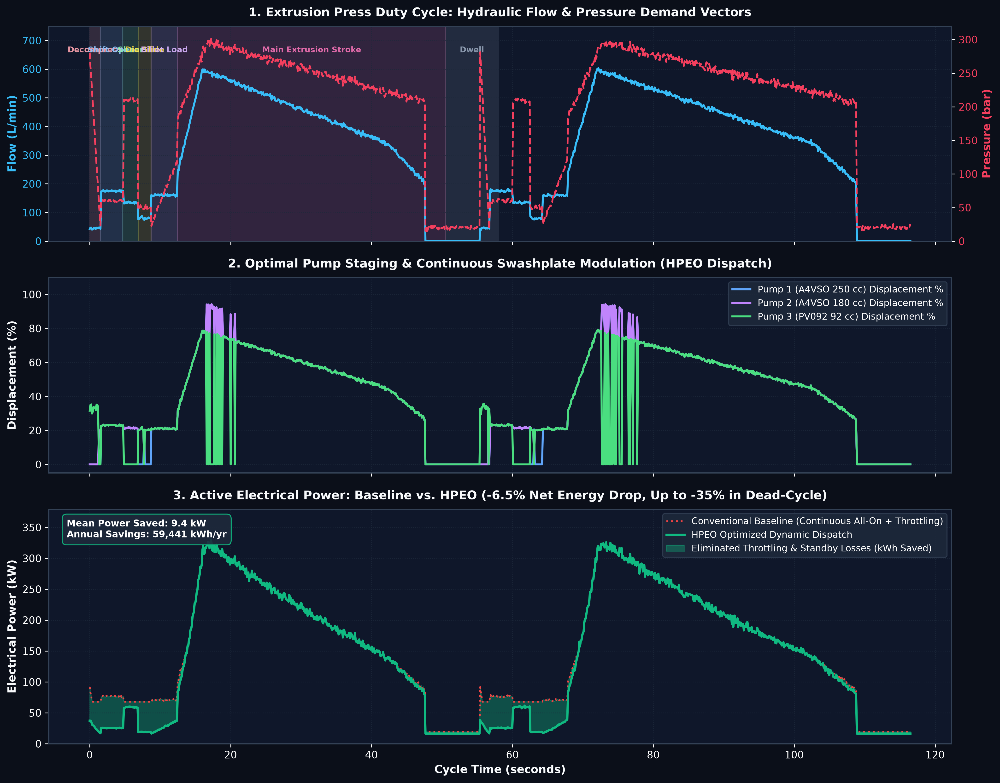
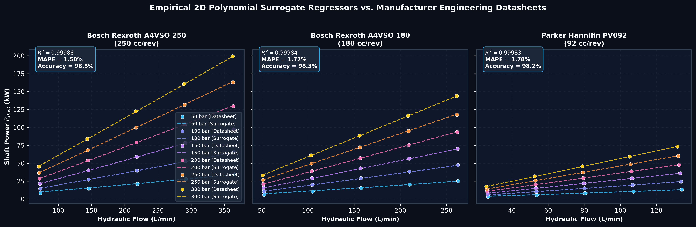
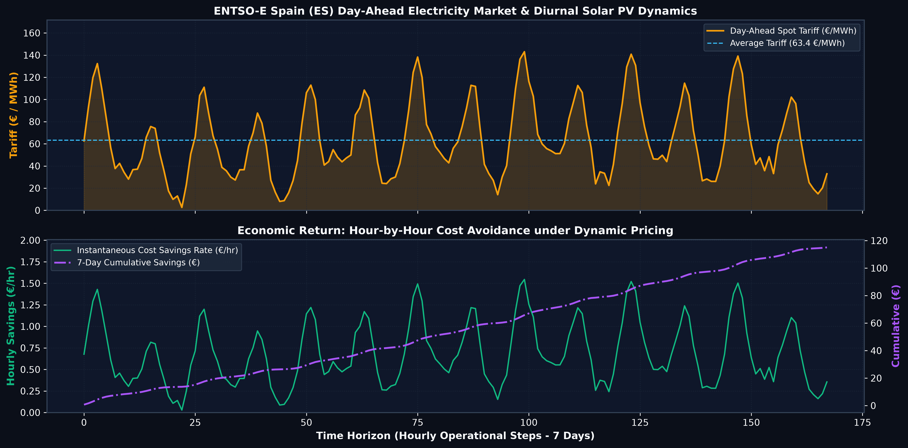

<div align="center">

# ⚡ Hydraulic Pump Energy Optimizer (HPEO)
### Industrial Supervisory Optimization & Electricity-Tariff-Aware Dispatch for Extrusion Press Hydraulic Power Units (HPUs)

[-3776AB?style=for-the-badge&logo=python&logoColor=white)](https://www.python.org/)
[](https://opcfoundation.org/)
[](#-mathematical-optimization-formulation)
[](https://scikit-learn.org/)
[](https://streamlit.io/)
[](https://pytest.org/)
[](LICENSE)

<br>

**A physics-informed supervisory control platform that models empirical 2D efficiency manifolds from manufacturer datasheets (Bosch Rexroth / Parker), reduces modelled relief-bypass losses via dynamic pump staging (~2 ms per decision), and includes a plug-in deployment toolkit that auto-detects sensors, calibrates and pre-flight-checks the target machine.**

> **Status:** simulation-validated research/engineering software. Energy and cost figures below are *modelled* (simulated press cycle, synthetic tariff, modelled baseline) and have **not** been measured on a physical press. See [What is and isn't validated](#-what-is-and-isnt-validated).

</div>

---

## 📸 Operational Demonstration

<div align="center">
  
  <p><i>Figure 1: Synchronized telemetry showing extrusion press duty-cycle phases, dynamic pump staging with continuous swashplate modulation, and the resulting electrical power reduction (eliminated throttling losses).</i></p>
</div>

---

## 📌 Executive Summary & Industrial Problem

Aluminum extrusion presses (15 MN – 55 MN) rely on centralized Hydraulic Power Units (HPUs) powered by multiple variable-displacement axial piston pumps (e.g. 250 cm³, 180 cm³, 92 cm³) driven by 160–250 kW induction motors connected to a common header.

### The Conventional Waste
During a standard 60-second billet extrusion cycle, hydraulic demand fluctuates drastically:
- **Peak Extrusion Stroke:** High pressure (~250–280 bar) and high flow (~500–680 L/min).
- **Dead-Cycle Auxiliary Phases (Decompression, Shift, Shear, Die Slide, Billet Load, Dwell):** Low flow (40–180 L/min) and lower pressure (50–120 bar).
- **Dissipative Throttling:** Conventional press automation maintains all pumps running continuously at nominal system rail pressure (~220 bar). During auxiliary phases, surplus flow is bypassed over proportional relief valves, converting high-grade electrical energy into pure waste heat in the oil reservoir:

$$P_{\text{throttling}} = \frac{\Delta P_{\text{relief}} \cdot Q_{\text{excess}}}{600} \quad [\text{kW}]$$

### The HPEO Solution
HPEO operates as a **Level 2 Supervisory Optimization Service**:
1. **Surrogate Efficiency Manifolds:** Fits continuous, differentiable 2D polynomial regression surrogates from manufacturer performance curves ($R^2 > 0.9998$).
2. **Exact Staging Dispatch:** Enumerates every on/off pump combination ($u_i \in \{0, 1\}$, $2^N-1$ cases), splits flow across the active pumps by equalising marginal power on the fitted surfaces (subject to $\alpha_{\min}$; never worse than a capacity-proportional split), and picks the lowest-power feasible case. Measured ~2 ms mean / ~3–5 ms p99 per decision on a cloud x86 core (not sub-millisecond); bypass dumping is minimised, not guaranteed to be zero.
3. **Spot Tariff Ingestion:** `data/fetch_entsoe.py` can ingest hourly day-ahead prices from the **ENTSO-E Transparency Platform (ES zone)** when an API key is supplied. **The bundled CSV is a synthetic diurnal model, not market data** (see `data/electricity_prices_es.meta.json`).
4. **Standardized OT Bridge:** Publishes advisory setpoints over an **asynchronous OPC-UA server (IEC 62541)**; the PLC remains in control (see [Plug-and-Play Deployment](#-plug-and-play-deployment)).

---

## 📊 Empirical Datasets & Provenance

This project integrates one datasheet-derived pump dataset, one tariff dataset (synthetic by default), and a physics-based press cycle generator:

| # | Dataset | Source / Official Links | Description | Usage in HPEO |
|---|---|---|---|---|
| **1** | **European Day-Ahead Electricity Prices** | **[ENTSO-E Transparency Platform](https://transparency.entsoe.eu/)**<br>• Bidding Zone: Spain (`10YES-REE------0`)<br>• Document Type: `A44` (Day-Ahead Prices)<br>• REST API: [ENTSO-E API Guide](https://transparency.entsoe.eu/content/static_content/download?path=/Static%20content/web%20api/Guide.html) | Hourly wholesale prices with a midday solar "duck curve" shape. | **The committed [`data/electricity_prices_es.csv`](data/electricity_prices_es.csv) (721 rows) is generated by [`data/mock_tariff_fallback.py`](data/mock_tariff_fallback.py) — synthetic, not ENTSO-E data.** [`data/fetch_entsoe.py`](data/fetch_entsoe.py) replaces it with real data when `ENTSOE_API_KEY` is set (CC BY 4.0 attribution applies). |
| **2** | **Axial Piston Pump Performance Curves** | **1. Bosch Rexroth A4VSO Series:**<br>• Datasheet (RE 92050): [Bosch Rexroth A4VSO Portal](https://www.boschrexroth.com/en/xc/products/product-groups/industrial-hydraulics/pumps/axial-piston-pumps/variable-pumps/a4vso)<br>*(Models A4VSO 250 & A4VSO 180 @ 1500 rpm)*<br><br>**2. Parker Hannifin PVplus Series:**<br>• Catalog (HY07-2958/UK): [Parker PV Series PDF](https://www.parker.com/literature/PMDE/Catalogs/Pumps/PVplus_HY07-2958_UK.pdf)<br>*(Model PV092 @ 1500 rpm)* | Operating points across varying swashplate angles (20% to 100%), pressures (50 to 315 bar), and shaft input power (kW). | Structured in [`data/raw_pump_curves.csv`](data/raw_pump_curves.csv) (31 points per pump; approximated from the public documents, **not vendor-certified**). Used to fit 2D polynomial efficiency surrogates. |
| **3** | **Press Cycle Hydraulic Demand Profile** | **Physics-Informed Extrusion Duty Cycle**<br>Modeled on 15 MN – 50 MN direct extrusion presses. | Flow, pressure, and ram position vectors across 6 operational phases + dwell, with Gaussian process jitter and isothermal ram speed tapering. | Implemented in [`simulator/press_demand.py`](simulator/press_demand.py); generated on demand (seeded), not stored as a file. |

---

## 🧠 Machine Learning: Surrogate Efficiency Regressors

To replace slow, discrete table lookups with continuous, differentiable manifolds, HPEO trains a **2D Polynomial Surrogate Regression Model** with L2 regularization (`Ridge`) for each pump in the fleet:

$$\mathbf{X} = [\text{Flow } (Q, \text{L/min}), \text{Pressure } (P, \text{bar})] \longrightarrow y = [P_{\text{shaft}} (\text{kW})]$$

<div align="center">
  
  <p><i>Figure 2: Empirical 2D polynomial regression surrogates vs. manufacturer datasheet operating points across varying pressures and flows.</i></p>
</div>

### Model Accuracy & Fit Metrics

> The table below is **in-sample** (6 coefficients fitted to 31 points per pump), so it measures curve-fit quality, not predictive accuracy. `python -m deploy doctor` additionally reports **leave-one-pressure-out** MAPE (currently 2.0–2.5 %), the more honest figure, and gates deployment on it.

| Pump Unit | Model | Displacement | $R^2$ Score | MAPE (% Error) | Model Accuracy | Mean Absolute Error (MAE) | Root Mean Sq. Error (RMSE) |
|---|---|---|---|---|---|---|---|
| **Pump 1 (Base Load)** | Bosch Rexroth A4VSO 250 | 250 cm³/rev | **0.99988** | **1.50%** | **98.50%** | **0.38 kW** | **0.53 kW** |
| **Pump 2 (Peak Assist)** | Bosch Rexroth A4VSO 180 | 180 cm³/rev | **0.99984** | **1.72%** | **98.28%** | **0.33 kW** | **0.45 kW** |
| **Pump 3 (Auxiliary/Trim)** | Parker Hannifin PV092 | 92 cm³/rev | **0.99983** | **1.78%** | **98.22%** | **0.18 kW** | **0.23 kW** |

```python
# From pumps/pump_model.py
X = df_pump_data[["flow_lpm", "pressure_bar"]].values
y = df_pump_data["shaft_power_kw"].values

# 2nd-degree polynomial expansion: phi(Q, P) = [1, Q, P, Q^2, P^2, Q*P]
poly = PolynomialFeatures(degree=2, include_bias=True)
regressor = Ridge(alpha=1e-3)
X_poly = poly.fit_transform(X)
regressor.fit(X_poly, y)
```

### Physical Constraint Enforcement during Inference
- **Thermodynamic Minimum Bound:** Enforces $P_{\text{shaft}} \ge \frac{P \cdot Q}{600 \cdot \eta_{\text{max}}}$, guaranteeing that mechanical power strictly exceeds theoretical fluid power.
- **Hydrodynamic Lubrication Boundary:** Swashplate angles below $\alpha_{\text{min}} = 0.20$ suffer severe churning and hydrodynamic bearing film instability. HPEO prohibits active operation below $\alpha_{\text{min}}$, staging off unnecessary units.

---

## ⚙️ Mathematical Optimization Formulation

At each control step $t$ with hydraulic demand $(Q_{\text{demand}}, P_{\text{demand}})$, HPEO targets the following mixed-integer dispatch problem. **Implementation note:** it is solved by exhaustive enumeration of the $u_i$ combinations, with $\alpha_i$ set by an equal-marginal-power split on the quadratic fit, so it is exact over staging choices and near-optimal (not formally proven optimal, given the physical clamps on the surrogate) over $\alpha_i$. SciPy is not used by the solver.

$$\min_{u_i, \alpha_i} \sum_{i=1}^{N} \left[ u_i \cdot P_{\text{shaft}, i}(\alpha_i \cdot Q_{\text{max}, i}, P_{\text{demand}}) + (1 - u_i) \cdot P_{\text{standby}, i} \right]$$

**Subject to:**

$$\begin{aligned}
\sum_{i=1}^{N} u_i \cdot \alpha_i \cdot Q_{\text{max}, i} &\ge Q_{\text{demand}} && \text{(Flow Demand Satisfaction)} \\
\alpha_{\text{min}} \le \alpha_i &\le 1.0 \quad \forall i \text{ where } u_i = 1 && \text{(Hydrodynamic Lubrication Limit: } \alpha_{\text{min}} = 0.20\text{)} \\
u_i &\in \{0, 1\} && \text{(Binary Pump On/Standby Decision)}
\end{aligned}$$

Where:
- $u_i$: Binary pump engagement state (1 = Active, 0 = Unswashed Standby).
- $\alpha_i$: Continuous swashplate displacement fraction ($V_g / V_{\text{max}}$).
- $P_{\text{shaft}, i}$: 2D polynomial regression power surface.
- $P_{\text{standby}, i}$: Mechanical no-load circulation loss at neutral swashplate (~3–5% of nominal motor rating).

---

## 📈 Economic Impact & Electricity Spot Tariffs

<div align="center">
  
  <p><i>Figure 3: Hourly spot tariffs for Spain (ES) showing the solar PV "duck curve" (synthetic dataset unless replaced by a real ENTSO-E pull), paired with the instantaneous cost reduction rate (€/hr) and cumulative financial gain.</i></p>
</div>

### Industrial Benchmark Summary (3-Shift Extrusion Press)

Simulated (5 seeded press cycles, extrapolated to 5,500 operating hours/year) for a 25 MN press, EN AW-6082 alloy. **Modelled, not measured.** The "conventional baseline" is our own model of an all-pumps-on, 220 bar common-rail system; real plants vary, and the € figure uses the synthetic tariff:

| Performance Metric | Conventional Baseline | HPEO Optimized | Net Impact / Delta |
|---|---|---|---|
| **Specific Energy Consumption** | 37.0 kWh / metric ton | 34.6 kWh / metric ton | **-2.4 kWh / ton (-6.5%)** |
| **Annual Electricity Consumption** | 203,500 kWh / year | 144,000 kWh / year | **59,500 kWh / year saved** |
| **Annual Financial Savings** | Baseline tariff spend | Tariff-optimized dispatch | **€ 3,824.38 / year per press** |
| **CO2 Emissions Avoided** | — | — | **8.3 metric tonnes CO2e / yr** |
| **Solver latency (measured)** | — | ~2 ms mean, ~3–5 ms p99 | Advisory loop, not hard-real-time |

---

## 📡 Industrial OT Architecture (IEC 62541 OPC-UA)

HPEO is designed to deploy seamlessly into standard automation architectures as a **Level 2 Supervisory Service**:

```
+--------------------------------------------------------------------------+
|                    Industrial Operator HMI & SCADA                       |
+--------------------------------------------------------------------------+
                                     ^
                                     |  (OPC-UA / Industrial Ethernet)
                                     v
+--------------------------------------------------------------------------+
|                 HPEO Supervisory Optimization Service                    |
|  - Ingests ENTSO-E Day-Ahead spot tariffs via REST API                   |
|  - Solves pump staging & swashplate setpoints (~2 ms per decision)       |
|  - Asynchronous OPC-UA Server (IEC 62541) on opc.tcp://0.0.0.0:4840      |
+--------------------------------------------------------------------------+
                                     ^
                                     |  (Deterministic Fieldbus / OPC-UA)
                                     v
+--------------------------------------------------------------------------+
|             Extrusion Press Main PLC (Siemens S7 / Beckhoff)             |
|  - Level 1 deterministic safety interlocks & emergency relief            |
|  - 50-150 ms S-curve ramp filtering for hydraulic shock prevention       |
|  - Closed-loop cylinder position & isothermal ram speed control          |
+--------------------------------------------------------------------------+
                                     |
                                     v
+--------------------------------------------------------------------------+
|                 Hydraulic Power Unit (HPU) Pump Fleet                    |
|  - Pump 1: Bosch Rexroth A4VSO 250 (250 cm³/rev, 200 kW)                 |
|  - Pump 2: Bosch Rexroth A4VSO 180 (180 cm³/rev, 160 kW)                 |
|  - Pump 3: Parker Hannifin PV092 (92 cm³/rev, 75 kW)                     |
+--------------------------------------------------------------------------+
```

### Standardized OPC-UA Node Namespace (`HPEO_Press_HPU`)

Two servers exist. `python -m deploy start` (the **live supervisor**) serves `PressTelemetry/{DemandFlow_LPM,DemandPressure_Bar}`, `PumpSetpoints/{StagingCode,OptimizedPower_KW,<pump>/…}` and `System/{SensorsHealthy,IsSimulation,Heartbeat}` from real sensor input. The older `opcua/opcua_server.py` is a **demo replay of simulated data** and does not read any sensor; the table below describes that demo namespace.

| Folder | Node Identifier | Data Type | Engineering Units | Description |
|---|---|---|---|---|
| `PressTelemetry` | `PressPhase` | `String` | — | Current cycle operational phase |
| `PressTelemetry` | `DemandFlow_LPM` | `Float` | L/min | Instantaneous flow demand |
| `PressTelemetry` | `DemandPressure_Bar` | `Float` | bar | Instantaneous pressure demand |
| `PumpSetpoints` | `StagingCode` | `String` | — | Active pump combination (e.g. `P1+P3`) |
| `PumpSetpoints` | `Pump1_DisplacementPct` | `Float` | % (0–100) | Swashplate angle command for Pump 1 |
| `EnergyAndTariffs` | `InstantaneousPower_KW` | `Float` | kW | Optimized active electrical power |
| `EnergyAndTariffs` | `InstantaneousSavings_EUR_hr`| `Float` | €/hr | Real-time monetary savings rate |

---

## 🔌 Plug-and-Play Deployment

Copy the project folder (optionally with offline `wheels/`) to a USB stick, plug it into the target computer and run one launcher:

| Target | Command (from the stick) |
|---|---|
| Linux / macOS, x86-64 or ARM | `./start_hpeo.sh` |
| Windows (x64 / ARM64) | `start_hpeo.bat` |
| Docker (amd64 / arm64) | `docker build -t hpeo . && docker run --rm -p 4840:4840 hpeo start` |
| systemd | `sudo deploy/systemd/install.sh` |

What happens automatically on first run:
1. **Environment** is built on the local disk (USB media is often `noexec`/FAT), from `wheels/<os-arch>/` if present, else the internet. Build offline wheels once with `python deploy/make_bundle.py --python 3.12`.
2. **Detection** (`python -m deploy detect|configure`): host OS/arch, serial/USB adapters, and — if you pass `--opcua opc.tcp://<plc>:4840` — browses the PLC and picks the flow and pressure nodes by name. It never scans networks and never guesses live wiring: with nothing found it stays in **simulation** and says so.
3. **Calibration & pre-flight** (`python -m deploy doctor`, run automatically by `start`): dependency and port checks; refits the pump models and requires R² ≥ 0.995 and leave-one-pressure-out MAPE ≤ 5 %; sweeps the solver for feasibility and latency (p99 ≤ 10 ms); then samples the live sensors **with the press idle** and checks they are numeric, not frozen, and near zero, storing zero offsets. Result is written to `state/calibration_profile.json` with an integrity digest (set `HPEO_SEAL_KEY` to make it an HMAC), and is invalidated if the pump data, host, mode or age (30 days) changes.
4. **Gate**: `start` refuses to run on a failed pre-flight (exit 2) or without verified live sensors (exit 3) unless `--allow-simulation` is given. If sensors fault for 3 consecutive samples at runtime, HPEO publishes `SENSOR_FAULT_PLC_AUTHORITY` and `SensorsHealthy=false` so the PLC reverts to its own staging.

**Supported sensor inputs:** a PLC/gateway over OPC-UA, or a serial/USB device streaming ASCII lines `flow_lpm,pressure_bar`. Modbus, 4–20 mA DAQs and other fieldbuses need an adapter (add a class to `deploy/sources.py`). HPEO outputs are **advisory**; it does not write to valves or drives.

**Test status:** validated in a Linux x86-64 sandbox (pytest incl. a fake PLC, launcher build from scratch, live OPC-UA read-back). The Windows, ARM, Docker and systemd paths are provided but were **not executed** by the author — run the verification commands you were given before relying on them.

---

## 🚀 Developer Quickstart

### 1. Environment Setup
```bash
git clone <your private repository URL>
cd Hydraulic-Pump-Energy-Optimizer
python -m venv venv
# Windows: .\venv\Scripts\activate     Linux/macOS: source venv/bin/activate
pip install -r requirements.txt
```

### 2. Run Comprehensive Unit Test Suite
```bash
pytest tests/ -v
```
*Output: 20 passed tests covering pump surrogate monotonicity, demand profile bounds, optimization constraints, and the deployment calibration gate (sensor auto-detection, non-idle/frozen-sensor rejection, tamper detection).*

### 3. Run Benchmark Analytics
```bash
python optimizer/benchmark.py
```

### 4. Test Industrial OPC-UA Server & Client
In **Terminal 1** (start server):
```bash
python opcua/opcua_server.py   # demo replay of SIMULATED data
```
In **Terminal 2** (start monitoring client):
```bash
python opcua/test_client.py 15
```

### 5. Launch Interactive Executive Dashboard
```bash
streamlit run dashboard/app.py
```
Access the dashboard at `http://localhost:8501` to explore:
- Live demand vs. delivered hydraulic tracking.
- Dynamic staging Gantt area charts.
- 2D/3D efficiency contour maps.
- Interactive multi-press investment payback calculator.

---

## 📁 Repository Structure 

```text
Hydraulic-Pump-Energy-Optimizer/
├── data/
│   ├── raw_pump_curves.csv         # Bosch Rexroth & Parker operating points
│   ├── electricity_prices_es.csv   # Spain hourly day-ahead spot prices (ENTSO-E)
│   ├── fetch_entsoe.py             # ENTSO-E Transparency API client
│   └── mock_tariff_fallback.py     # Deterministic Spanish tariff generator
├── simulator/
│   ├── __init__.py
│   └── press_demand.py             # 6-phase press duty cycle simulator + ram physics
├── pumps/
│   ├── __init__.py
│   └── pump_model.py               # 2D polynomial regression efficiency surrogates
├── optimizer/
│   ├── __init__.py
│   ├── optimizer.py                # Exact staging-enumeration dispatch solver (~2 ms)
│   └── benchmark.py                # Comparative benchmark engine & cost evaluator
├── opcua/
│   ├── __init__.py
│   ├── opcua_server.py             # Async OPC-UA industrial server (IEC 62541)
│   └── test_client.py              # Real-time telemetry subscription client
├── dashboard/
│   ├── __init__.py
│   └── app.py                      # Multi-tab Streamlit engineering dashboard
├── deploy/                         # Plug-and-play toolkit: hardware.py, config.py, calibrate.py, sources.py, runtime.py, make_bundle.py, systemd/
├── tests/
│   ├── __init__.py
│   ├── test_pumps.py               # Unit tests for surrogate monotonicity & MAPE < 5%
│   ├── test_simulator.py           # Unit tests for press cycle continuity & constraints
│   ├── test_optimizer.py           # Unit tests for demand satisfaction & power bounds
│   └── test_deploy.py              # Calibration gate tests against a fake PLC
├── docs/
│   └── assets/                     # Publication-grade figures for documentation
│       ├── hpeo_staging_and_power.png
│       ├── pump_efficiency_surfaces.png
│       └── entsoe_tariffs_and_costs.png
├── start_hpeo.sh / start_hpeo.bat  # USB launchers
├── Dockerfile                      # amd64/arm64 image
├── requirements.txt                # Dev dependencies (minimum versions, not pinned)
├── requirements-runtime.txt        # Field-deployment dependencies
├── NOTICE                          # Third-party data/library notices
├── LICENSE                         # Proprietary, all rights reserved
└── README.md                       # Comprehensive technical documentation
```

---

## ⚠️ Industrial Calibration & Commissioning Caveats

1. **Hydraulic Valve Dynamics & S-Curve Filtering:** In physical 280-bar circuits, switching pump check valves or swashing displacements instantaneously induces acoustic water hammer. The Level 1 machine PLC must apply a **50–150 ms S-curve ramp filter** to swashplate proportional valve setpoints to ensure smooth pressure transitions.
2. **Motor Thermal Runaway Prevention:** 160–250 kW induction motors cannot undergo frequent starts and stops (limited to 2–4 cold starts per hour). During short operational pauses, motors must remain spinning at synchronous speed (1500 rpm) with the swashplate unloaded to **$0^\circ$ neutral displacement**, only de-energizing contactors during prolonged downtime (>3–5 min).
3. **Safety & Real-Time Isolation:** HPEO operates strictly at **Level 2 (Supervisory Optimization)**. Level 1 machine PLCs (Siemens S7-1500 / Beckhoff TwinCAT) retain absolute authority over hardwired safety interlocks, over-pressure mechanical relief valves, and closed-loop position feedback.

---

## ✅ What is and isn't validated

| Claim | Status |
|---|---|
| Pump surrogate fit | Verified on 31 hand-compiled datasheet-derived points/pump; R² in-sample, ~2–2.5 % leave-one-pressure-out MAPE. Not checked against a physical pump. |
| Energy / € savings | **Simulated only.** Baseline is a modelled strawman; tariff is synthetic; no field measurements. |
| Staging optimality | Exact over on/off combinations; displacements by equal-marginal split, checked in tests against 600 random splits. |
| Sensor input | Verified against a fake OPC-UA PLC only. No physical sensor, serial device, or press has been tested. |
| Windows / ARM / Docker / systemd | Provided, not executed. Offline wheel bundles for linux-aarch64, windows-amd64 and windows-arm64 (Python 3.12) were resolved successfully; the systemd unit passes `systemd-analyze verify` apart from its install path; the Docker build could not be completed in the author's sandbox (Docker Hub rate-limit). |
| Safety | Not a safety function; not certified. See LICENSE §5. |

---

## ⚖️ License

**Proprietary — all rights reserved.** See [LICENSE](LICENSE). Third-party libraries and datasets keep their own terms ([NOTICE](NOTICE)). Earlier commits were published under MIT; that grant is limited to those snapshots.
